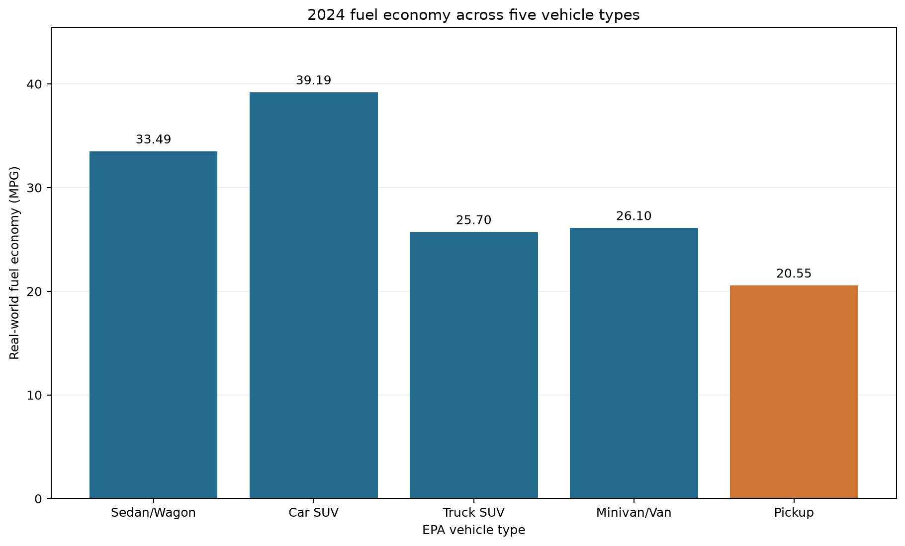
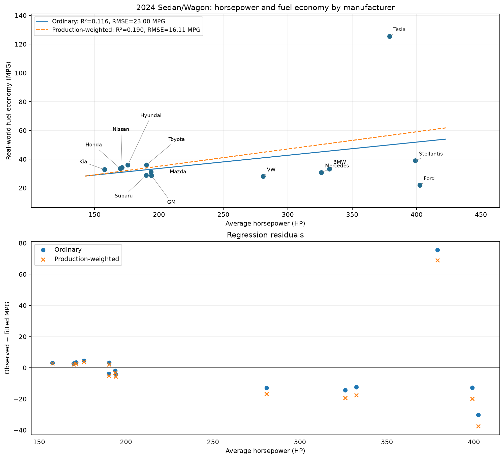
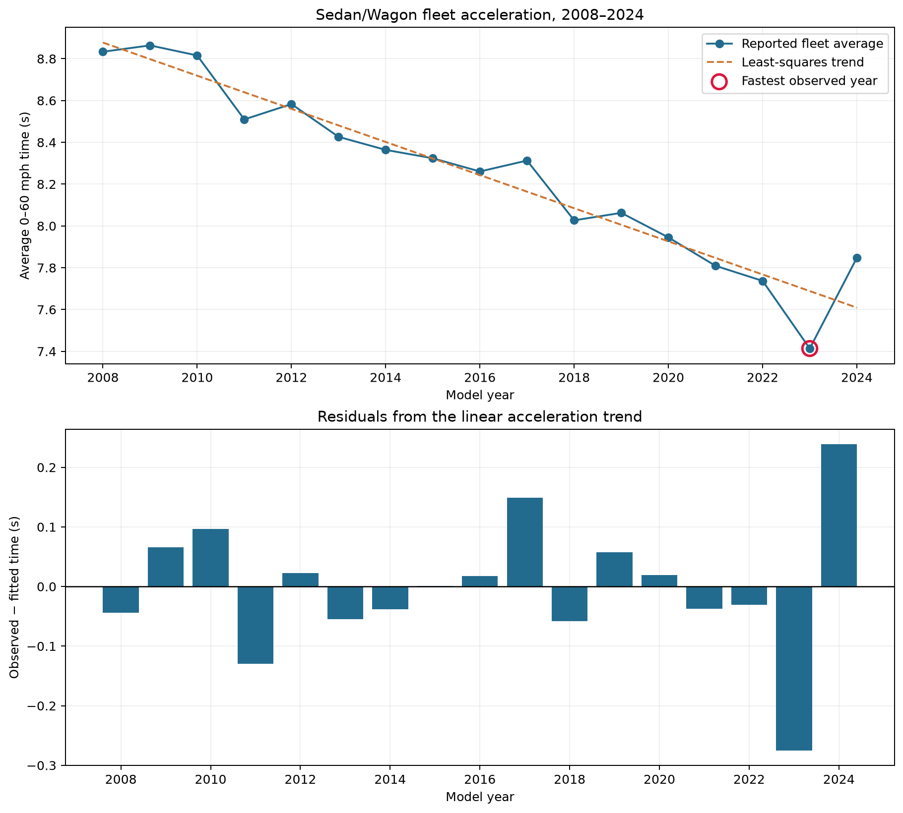

# Automotive Trends

ENGR 315 — Semester Project

## Team Name and Contributors

**Team:** Python Warriors  
**Contributors:** Van Lawler and Luis Nieves

## Objective and Motivation

This project will use EPA Automotive Trends data to compare fuel economy across vehicle classifications, examine the relationship between horsepower and fuel economy, and identify the model year with the fastest average Sedan/Wagon acceleration. Least-squares fitting will be used for the horsepower and acceleration questions.

Our shared interest in automotive systems and engineering motivated this project. We first worked together on an autonomous vehicle in ENGR 112 under Dr. Gipson and successfully accomplished our objectives. As seniors, we chose this project to revisit that interest and deepen our understanding of the automotive industry.

### Dataset

The source is the [EPA Automotive Trends dataset](https://www.epa.gov/automotive-trends/explore-automotive-trends-data), which can be explored online or exported as a CSV. EPA uses manufacturer-submitted data received through its regulatory programs. The repository's `table_export.csv` contains 5,661 records and 57 columns, with model-year labels from 1975 through 2024 and a separate `Prelim. 2025` label. The planned analyses use finalized model years through 2024, following the Phase 0 proposal.

The relevant fields are:

| Field | Use |
| --- | --- |
| `Manufacturer`, `Model Year` | Select manufacturer groups and analysis years. |
| `Regulatory Class`, `Vehicle Type` | Define comparable vehicle groups and avoid overlapping categories. |
| `Real-World MPG` | Primary fuel-economy measure, in miles per gallon. |
| `Real-World MPG_City`, `Real-World MPG_Hwy` | Optional city/highway comparisons, kept separate from combined MPG. |
| `Horsepower (HP)` | Explanatory variable for the horsepower–fuel-economy fit. |
| `Acceleration (0-60 time in seconds)` | Acceleration measure; a lower value means faster acceleration. |
| `Production (000)`, `Production Share` | Production context and weights for the manufacturer regression. |
| Powertrain share columns | Examine the possible influence of BEVs, plug-in hybrids, and other hybrids. |

### Selected Questions, Expected Answer Forms, and Benefits

The question numbers below retain the numbering from the proposal. All numerical expectations are **preliminary values reported in Phase 0**, to be reproduced and checked in later phases.

| Question | Expected answer form | Potential benefit |
| --- | --- | --- |
| **Q2. How significantly does fuel economy vary between different vehicle classifications?** | A table and bar chart of 2024 real-world MPG for five non-overlapping vehicle types, with absolute MPG differences and percentage differences relative to a stated baseline. The proposal reports an expected cars/SUVs-versus-pickups difference of 18.64 MPG (90.7%); the exact cars/SUVs grouping and averaging rule must be documented when reproducing it. | Show the size of fuel-economy differences among vehicle types and support informed comparisons. |
| **Q4. What is the relationship between engine horsepower and fuel efficiency?** | Unweighted and production-weighted linear equations, slopes, R², RMSE, and diagnostic plots for 2024 Sedan/Wagon averages across 14 manufacturer groups. The proposal's preliminary unweighted fit is MPG = 15.22 + 0.0917(HP), with R² = 0.116 and RMSE = 23.00 MPG. | Assess how well horsepower alone describes fuel economy across a fleet with mixed powertrains. |
| **Q5. Which year produced the fastest average 0–60 mph cars?** | The year with the lowest reported annual Sedan/Wagon average time during 2008–2024, plus a fitted trend, slope, R², RMSE, and residual plot. The proposal identifies 2023 at 7.4135 s and a preliminary trend of −0.07927 s/year, R² = 0.927, and RMSE = 0.109 s. | Quantify changes in average acceleration and identify the fastest year within the selected period. |

## Introduction / Context of the Project

The CSV contains aggregate fleet and manufacturer records, rather than independent observations for individual cars. It includes both broad totals (`All`, `All Car`, and `All Truck`) and narrower vehicle types. Mixing these levels would double-count groups. The five non-overlapping types used for Q2 are Sedan/Wagon, Car SUV, Truck SUV, Minivan/Van, and Pickup.

For Q4 and Q5, “cars” refers specifically to Sedan/Wagon, matching the proposal. Relationships among aggregate averages do not establish vehicle-level relationships or causation. Powertrain mix, production volume, and other vehicle characteristics can influence the comparisons. Q2 addresses the magnitude of observed differences; aggregate class averages alone do not support a vehicle-level statistical significance test.

The selected scope is Q2, Q4, and Q5. The proposal deferred the CO₂ questions because the chosen export lacked a CO₂ field; the manufacturer acceleration question was considered but not selected.

## Implementation Details

**Progress report — October 28, 2026:** All three selected question/method pairs have been implemented and run against the repository CSV. The scripts print metrics and save tables and Matplotlib figures in `results/`. The methods below describe the implemented analyses; powertrain subset modeling beyond the Tesla sensitivity check remains future work.

### Run the Analyses

From the repository folder, create an environment and install dependencies:

```bash
python3 -m venv .venv
source .venv/bin/activate
python -m pip install -r requirements.txt
python script.py
```

Run questions individually with `python q2_vehicle_classes.py`, `python q4_horsepower.py`, or `python q5_acceleration.py`. Paths are resolved relative to the scripts, so data loading does not depend on the current working directory. Figures are saved without requiring a graphical display. Each run regenerates the corresponding printed-output transcript, CSV table, and PNG plot. The tested versions and input SHA-256 are recorded in [results/environment.txt](results/environment.txt); the original export date and portal filter history were not recorded in the repository.

| Source code | Method and saved evidence |
| --- | --- |
| [q2_vehicle_classes.py](q2_vehicle_classes.py) | Class MPG comparison; `results/q2_*`. |
| [q4_horsepower.py](q4_horsepower.py) | Ordinary and production-weighted regression; `results/q4_*`. |
| [q5_acceleration.py](q5_acceleration.py) | Annual minimum and linear trend; `results/q5_*`. |
| [analysis_common.py](analysis_common.py) | CSV cleaning, least-squares calculation, metrics, and output helpers. |
| [script.py](script.py) | Runs all three analyses. |

### Tools and Data Preparation

- **Python and pandas:** import the CSV, select records, clean fields, and produce comparison tables.
- **NumPy:** calculate differences, fit ordinary and weighted least-squares models, and compute model metrics.
- **Matplotlib:** create labeled comparison, regression, time-series, and residual plots. VS Code will be used for development.
- Preserve `table_export.csv` as the source export. Record its source, export filters, retrieval date, and the Python/package versions when implementing the analysis.
- Treat `-` and blank numeric cells as missing, convert numeric fields explicitly, and exclude `Prelim. 2025`. Remove missing values only for fields required by each analysis, recording the excluded counts.
- Select a single aggregation level for each question. Check uniqueness by manufacturer, year, regulatory class, and vehicle type. Do not mix `Manufacturer = All` totals with individual manufacturer rows in the same fit.
- Keep combined, city, highway, and 2-cycle MPG measures distinct. Inspect unusual observations and powertrain shares before deciding whether any exclusion is justified; document all exclusions.

### Q2 — Fuel Economy by Vehicle Classification

1. Filter to model year 2024 and `Manufacturer = All`. Select the five non-overlapping vehicle types and their matching regulatory classes: Sedan/Wagon and Car SUV are `Car`; Truck SUV, Minivan/Van, and Pickup are `Truck`.
2. Use each selected EPA aggregate's `Real-World MPG` directly. Report a comparison table and identify the highest and lowest values.
3. For class MPG value M and pickup baseline P, calculate the absolute difference as M − P and the percentage difference as 100 × (M − P) / P. State the baseline beside every percentage. If reproducing the proposal's combined cars/SUVs comparison, specify which types it includes and whether its average is weighted; do not treat overlapping total rows as additional types.
4. Produce a bar chart of MPG by vehicle type and a table of absolute and percentage differences. Discuss potential explanations as hypotheses, including powertrain and vehicle characteristics.

### Q4 — Horsepower Versus Fuel Economy

1. Filter to 2024, `Vehicle Type = Sedan/Wagon`, and `Regulatory Class = Car`. Exclude `Manufacturer = All`, retain complete horsepower–MPG pairs, and verify the proposal's 14 manufacturer groups.
2. Fit MPG = a + b × HP by ordinary least squares, minimizing the sum of squared MPG residuals. Each manufacturer group receives equal weight.
3. Fit the same equation using positive `Production (000)` values as weights, minimizing the sum of production-weighted squared residuals. Normalize weights if needed; this does not change the coefficients. Compare both fits on the same eligible groups.
4. Report intercept, slope in MPG/HP, sample count, R², and RMSE in MPG for each fit. For weighted metrics, use the weighted mean and weighted sums consistently and label them separately from unweighted metrics.
5. Plot MPG against HP with manufacturer labels and both fitted lines. Add residual-versus-HP or residual-versus-fitted plots. Examine BEV and hybrid shares where available to assess whether powertrain mix helps explain influential observations; label any subset fit separately.

The positive preliminary slope and low R² in the proposal are a reason to inspect the mixed-powertrain data carefully. They do not establish that increasing a vehicle's horsepower improves its fuel economy.

### Q5 — Acceleration Trends by Model Year

1. Filter to `Manufacturer = All`, `Vehicle Type = Sedan/Wagon`, `Regulatory Class = Car`, and model years 2008–2024. Use one reported fleet-average acceleration value per year and verify coverage of all 17 years.
2. Identify the minimum observed 0–60 mph time and report its year and time, including ties if present. The fastest observed year is determined from the data, independently of the fitted line.
3. Fit time = a + b × (year − 2008) by ordinary least squares. Centering the year makes the intercept easier to interpret while retaining slope units of seconds/year.
4. Report slope, intercept, sample count, R², and RMSE in seconds. Plot annual times with the fitted trend and highlight the observed minimum. Plot residuals against year to inspect curvature, unusual years, and remaining time patterns.
5. Interpret a negative slope as shorter average acceleration times over the selected period. Discuss changing fleet composition and powertrain technology as possible influences without claiming causation or extrapolating beyond the study period.

### Metrics and Documentation

For unweighted fits, residuals are observed values minus fitted values. RMSE = sqrt(sum(residual²) / n), and R² = 1 − sum(residual²) / sum((observed − mean(observed))²). Weighted versions use production weights in both the error sums and the mean, with RMSE divided by the sum of weights.

The workflow is: load the preserved CSV → filter one aggregation level → validate coverage and required fields → calculate comparisons or fit regressions → print metrics → save CSV tables and PNG figures. Actual command-line output and plots are included below. No required numeric values were missing in the selected five class rows, 14 manufacturer rows, or 17 annual rows.

## Results (Answers to the Questions)

These findings were generated from `table_export.csv` by the included scripts on October 28, 2026. All selected records passed coverage/uniqueness checks. Preliminary 2025 rows and overlapping aggregate totals were excluded by the explicit filters.

### Q2 — Fuel Economy by Vehicle Classification

Car SUVs have the highest reported 2024 real-world fuel economy (39.18900 MPG), while pickups have the lowest (20.54899 MPG). Car SUVs exceed pickups by 18.64001 MPG, or 90.71010% relative to pickups. Sedan/Wagon averages 33.48734 MPG, Truck SUV 25.70378 MPG, and Minivan/Van 26.09710 MPG.

**Correction to Phase 0:** The proposal's 18.64 MPG (90.7%) comparison matches **Car SUV versus Pickup**. It does not represent all cars and SUVs combined. The equal-type arithmetic mean of Sedan/Wagon, Car SUV, and Truck SUV is 32.79337 MPG, 59.58630% above pickups; this is a descriptive mean of three group values, not a combined fleet MPG. These aggregate comparisons quantify magnitude, not statistical significance.

**Command-line output** (also saved in [q2_output.txt](results/q2_output.txt)):

```text
Q2 — 2024 real-world MPG by vehicle type
Included = 5 aggregate rows; missing required values = 0
Vehicle Type  Real-World MPG  Difference vs pickup (MPG)  Difference vs pickup (%)
 Sedan/Wagon        33.48734                    12.93835                  62.96344
     Car SUV        39.18900                    18.64001                  90.71010
   Truck SUV        25.70378                     5.15479                  25.08537
 Minivan/Van        26.09710                     5.54811                  26.99943
      Pickup        20.54899                     0.00000                   0.00000
Highest MPG: Car SUV (39.18900 MPG)
Pickup baseline: 20.54899 MPG
Equal-type mean of Sedan/Wagon, Car SUV, Truck SUV: 32.79337 MPG
That mean minus pickup: 12.24438 MPG (59.58630%)
This equal-type mean is descriptive, not a production-weighted fleet MPG. No significance test is inferred from aggregate averages.
```



[Download the metrics table](results/q2_metrics.csv).

### Q4 — Horsepower Versus Fuel Economy

All 14 manufacturer groups had complete required values and positive production. The ordinary fit is **MPG = 15.222498 + 0.09166969 × HP**, with R² = 0.115829 and RMSE = 23.000492 MPG. The production-weighted fit is **MPG = 11.134739 + 0.11982547 × HP**, with weighted R² = 0.190014 and weighted RMSE = 16.109810 MPG. The metrics use different weighting, so their error values do not constitute a like-for-like predictive ranking.

Both fits describe a weak relationship. Tesla has 125.51497 MPG and a large positive ordinary-fit residual of 75.54530 MPG. Its BEV share is 1.0 in the export; other groups also contain electrified vehicles, so excluding Tesla does not isolate gasoline-only vehicles. A separately labeled sensitivity fit excluding Tesla gives a slope of −0.01096122 MPG/HP, R² = 0.051151, and RMSE = 4.114579 MPG. The slope reversal shows sensitivity to fleet composition. Tesla remains in both primary fits. These are in-sample descriptive fits, with no causal or held-out predictive claim. Powertrain share fields are preserved in the saved table; a fuller multivariable analysis is still needed.

**Command-line output** (also saved in [q4_output.txt](results/q4_output.txt)):

```text
Q4 — 2024 Sedan/Wagon manufacturer averages
Selected = 14; included = 14; excluded missing/nonpositive production = 0
Equation: MPG = intercept + slope × HP
Ordinary least squares (equal manufacturer weight): n = 14
  intercept = 15.222498; slope = 0.09166969 MPG/HP
  R² = 0.115829; RMSE = 23.000492
Production-weighted least squares (weighted R² and RMSE): n = 14
  intercept = 11.134739; slope = 0.11982547 MPG/HP
  R² = 0.190014; RMSE = 16.109810
RMSE units: MPG. Metrics are in-sample descriptive fit measures, not held-out prediction scores.
Sensitivity only: ordinary fit excluding Tesla: n = 13
  intercept = 34.545010; slope = -0.01096122 MPG/HP
  R² = 0.051151; RMSE = 4.114579
```



[Download the metrics table](results/q4_metrics.csv).

### Q5 — Fastest Annual Average Acceleration

Among the 17 annual Sedan/Wagon fleet averages from 2008–2024, **2023 was fastest at 7.4135 seconds** for 0–60 mph. The least-squares equation is **time (s) = 8.877390 − 0.07926642 × (year − 2008)**, with R² = 0.927063 and RMSE = 0.108921 s. This reproduces the proposal's rounded trend metrics.

The observed average fell from 8.8335 s in 2008 to 7.8476 s in 2024, a reduction of 0.9859 s. Improvement was not monotonic: 2024 was 0.4341 s slower than 2023. The largest absolute residual is 0.274894 s in 2023; 2024 also lies above the fitted line. Thus, a strong overall linear trend does not imply that every successive year is faster, and the minimum is selected from observed values rather than the fitted line.

**Command-line output** (also saved in [q5_output.txt](results/q5_output.txt)):

```text
Q5 — Sedan/Wagon annual fleet acceleration, 2008–2024
Selected = 17; included = 17; missing acceleration = 0
Fastest observed year(s): 2023; average 0–60 mph time = 7.4135 s
Equation: time (s) = intercept + slope × (year − 2008)
Ordinary least squares: n = 17
  intercept = 8.877390; slope = -0.07926642 s/year
  R² = 0.927063; RMSE = 0.108921
Observed 2008 to 2024 change = -0.9859 s
Largest absolute residual = 0.274894 s
RMSE units: seconds. Lower time means faster acceleration; the fitted trend does not determine the observed minimum.
```



[Download the metrics table](results/q5_metrics.csv).

## Conclusions

1. **Vehicle type:** Car SUVs lead the five 2024 vehicle types in reported real-world MPG, and pickups have the lowest MPG. The proposal's numerical difference was reproduced, with its comparison corrected to Car SUV versus Pickup.
2. **Horsepower:** Horsepower alone explains little of the variation in manufacturer-average fuel economy in this mixed-powertrain sample. Production weighting changes the fit, and the slope reverses when Tesla is excluded as a sensitivity check. This evidence does not support a causal statement about horsepower improving fuel economy.
3. **Acceleration:** 2023 has the lowest reported annual Sedan/Wagon 0–60 mph time during 2008–2024. A negative fitted slope summarizes the overall improvement, but the slower 2024 average shows that the trend is not monotonic.

The findings describe aggregate manufacturer or fleet averages, not individual vehicle performance. Class composition, electrification, production volume, and other characteristics remain possible influences. No inferential significance test or out-of-sample prediction study was performed.

## Actions that Need to Be Completed

- [x] Load the dataset and define non-overlapping analysis groups for Q2, Q4, and Q5.
- [x] Implement separate scripts, printed metrics, tables, and labeled plots for all three questions.
- [x] Run the analyses and compare findings with Phase 0 expectations.
- [x] Document results, conclusions, commands, dependencies, and the tested environment.
- [ ] Recover the source export date and filter history if available. Issue: the original CSV does not record that provenance; its SHA-256 is saved for reproducibility.
- [ ] Review EPA definitions for mixed-powertrain fuel-economy interpretation and acceleration methodology before the final presentation.
- [ ] Investigate powertrain mix with additional subsets or multivariable models. Issue: aggregate manufacturer averages cannot isolate vehicle-level effects, and removing Tesla does not remove all EVs.
- [ ] Have a teammate rerun the documented commands in a fresh environment and review figures and interpretations.
- [ ] Commit and push the reviewed code and results to GitHub, then prepare the report/presentation materials. Local files have been prepared; no remote publication is claimed.

## References / Source Files

1. Lawler, Van, and Luis Nieves. [ENGR 315 Project Proposal Phase 0](https://docs.google.com/document/d/1lZWqDVpIDsLwhNl9FWUNwnT43zpCnR5gD58CyNgnr3M/edit). Source of the project scope, selected questions, and preliminary expectations.
2. U.S. Environmental Protection Agency. [Explore the Automotive Trends Data](https://www.epa.gov/automotive-trends/explore-automotive-trends-data). Dataset portal; accessed October 28, 2026. The portal is updated over time; retain the repository export and document its provenance for reproducibility.
3. U.S. Environmental Protection Agency. [The 2024 EPA Automotive Trends Report Executive Summary](https://nepis.epa.gov/Exe/ZyPDF.cgi?Dockey=P101CUZD.pdf). Reference cited in the proposal, accessed there on October 19, 2026.
4. [`table_export.csv`](table_export.csv) — EPA data export currently included in this repository.
5. [`Full Report Publication.pdf`](Full%20Report%20Publication.pdf) — report file currently included in this repository.
6. [`script.py`](script.py), the three `q*_*.py` analysis files, and [`analysis_common.py`](analysis_common.py) — implemented project analysis source files.
7. [Automotive Trends GitHub repository](https://github.com/LuisNieves05/Automotive-Trends-) — project source repository.
